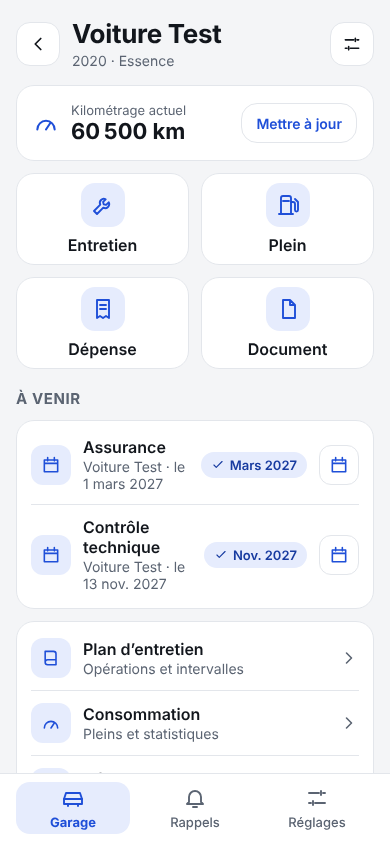
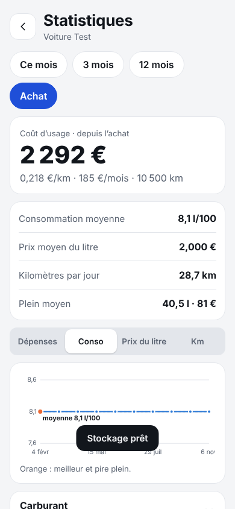
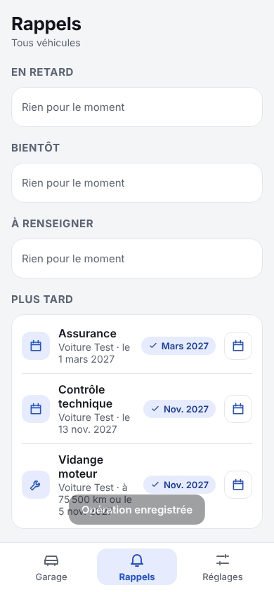
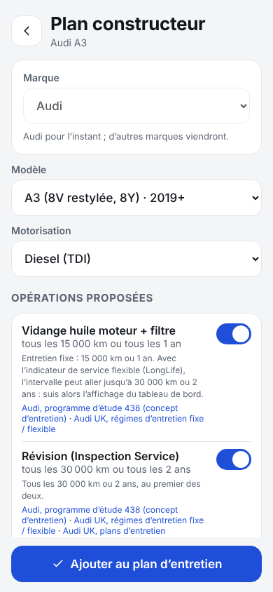

<div align="center">


# AutoBio

**L'autobiographie de tes véhicules.**
Entretiens, rappels, pleins, dépenses, documents… et des statistiques pour comprendre ce que ta voiture te coûte vraiment.

*par GenyusLabs · application Android · 100 % en français*

</div>

---

## En un coup d'œil

| | |
|---|---|
| 🔧 **Entretien** | Un plan d'entretien par véhicule, avec des rappels en km et en date |
| ⛽ **Pleins** | Consommation, prix du litre, autonomie, enseignes |
| 📸 **Lecture photo** | Photographie la pompe ou le compteur : litres, montant et kilomètres se remplissent tout seuls |
| 📊 **Statistiques** | Coût au km, coût par mois, records, qualité des données |
| 🔔 **Rappels** | Notifications le matin à 9 h, même appli fermée |
| 📅 **Agenda** | Ajout d'une échéance à Google Agenda en un appui |
| 💾 **Sauvegarde** | Un seul fichier JSON, copies automatiques, restauration facile |

<p align="center">
  
  
  
  
</p>

*(captures réalisées avec un véhicule fictif)*

---

## 📸 Lecture photo

Dans les formulaires **Plein**, **Entretien** et **Dépense**, un bouton photographie ce que tu veux saisir :

- **Lire la pompe** : cadre l'écran de la pompe. L'appli repère le montant, les litres et le prix au litre, et vérifie qu'ils sont cohérents entre eux (montant ≈ litres × prix) avant de remplir les champs.
- **Lire le compteur** : cadre le compteur kilométrique. L'appli ignore le compteur partiel et choisit le nombre le plus proche de ton dernier kilométrage connu.

Le bouton ouvre **directement l'appareil photo**. La lecture se fait **sur le téléphone**, sans connexion ni service en ligne (reconnaissance de texte ML Kit embarquée). La photo n'est jamais enregistrée dans ta photothèque : elle reste dans l'espace privé de l'appli le temps de la lecture, puis elle est supprimée. Rien n'est envoyé. Les champs sont seulement pré-remplis, **vérifie toujours les chiffres avant d'enregistrer**. Disponible dans l'application Android uniquement.

## 📊 Statistiques

Un seul écran, léger à lire : un gros chiffre, quatre chiffres clés, un graphique que tu choisis, puis quatre sections repliées.

- **Période** au choix : ce mois, 3 mois, 12 mois, depuis l'achat.
- **Chiffre principal** : coût d'usage (carburant + entretien + autres frais), avec le coût au km, le coût par mois et les kilomètres parcourus.
- **Graphiques** : dépenses par mois, consommation à chaque plein, prix du litre, kilomètres par mois.
- **Carburant** : litres, dépensé, autonomie moyenne, délai entre pleins, détail par enseigne.
- **Coûts** : répartition, derniers entretiens, prix d'achat, coût de possession, projection sur 12 mois.
- **Records** : meilleure et pire consommation, plein le plus cher, plus gros plein, litre le moins cher, plus longue distance.
- **Qualité des données** : repère les intervalles entre pleins exclus des moyennes (par exemple un plein oublié), pour que les chiffres restent justes.

> Le coût réel au km « achat inclus » reste indicatif : il répartit le prix d'achat sur les kilomètres enregistrés dans l'appli.

## 🔧 Entretien et plans constructeur

Dans la fiche véhicule, **Plan d'entretien › Charger un plan constructeur** (proposé automatiquement à la création d'un véhicule Audi).

- Catalogue Audi depuis 2019 (`js/catalog.js`), calculé **par modèle et par motorisation** : essence, diesel, hybride rechargeable, sportive, électrique. Un électrique n'a ni vidange ni bougies, un diesel a un filtre à carburant, une Q7 a une boîte tiptronic, un TT une S tronic et un coupleur quattro, etc.
- **Sources uniquement françaises ou d'Europe de l'ouest** : catalogue d'entretien Audi Service France 2016 (TT, A3, A4, A5, A6, A7, Q3, Q5), programme d'étude Audi 438 (version française), Audi France, Audi UK pour l'électrique, guides d'atelier allemands qui s'appuient sur les données constructeur. Chaque opération indique ses sources, avec un lien.
- **Rien n'est deviné.** Audi ne publie pas de tableau public par modèle. Quand les sources ne confirment pas une valeur (huile de boîte tiptronic de l'A8, S tronic à embrayage sec des petits moteurs, courroie ou chaîne selon le moteur…), l'opération est proposée désactivée avec l'explication, ou absente.
- **Valeurs retenues** : entretien LongLife 30 000 km ou 2 ans, liquide de frein au bout de 3 ans puis tous les 2 ans, filtre d'habitacle tous les 2 ans, filtre à air 90 000 km, bougies 60 000 km ou 6 ans, huile de boîte S tronic 60 000 km, électrique : inspection tous les 2 ans.
- Ce sont des repères : **le carnet d'entretien et l'indicateur de service du véhicule restent la référence.**

## 🔔 Rappels, notifications et agenda

- **Rappels** : chaque échéance (opération du plan, contrôle technique, assurance) est suivie en km et/ou en date. Les échéances en km sont converties en date estimée d'après ton rythme de conduite.
- **Notifications** : dans l'APK, elles sont programmées à 9 h (quelques jours avant, puis le jour même) et reprogrammées à chaque modification. Sur le web, elles s'affichent à l'ouverture de l'appli.
- **Google Agenda** : un bouton *Ajouter à l'agenda* sur chaque échéance. Sur le web, il ouvre Google Agenda avec l'événement pré-rempli. Dans l'APK, il crée l'événement en un appui. L'aperçu affiche le titre exact avant l'ajout.
- **Pop-up intelligent** : après un entretien, la création d'une opération ou un changement de date de contrôle technique ou d'assurance, l'appli propose d'ajouter la prochaine échéance. Désactivable dans les Réglages.

## 💾 Tes données

Tout vit dans **un seul document de travail JSON**, remplacé automatiquement à chaque modification :

```
AutoBio_live-data.json
```

Il contient une clé `_note` (en anglais) qui rappelle qu'il est créé par AutoBio.

**Où il est rangé.** Dans l'APK, tu choisis l'emplacement avec le sélecteur de fichiers d'Android. Choisis « Drive » pour le retrouver sur tous tes appareils, ou garde-le sur le téléphone. Aucune API Google, aucune configuration. Les photos et documents restent sur le téléphone.

**Nouveau téléphone ou réinstallation.** Au premier lancement, l'appli demande « As-tu déjà utilisé AutoBio ? ». Si oui, elle relie ton document et retrouve tout.

**Dans un navigateur**, sans sélecteur de fichiers, les données restent dans le navigateur, avec copie manuelle et restauration depuis un fichier.

### Les filets de sécurité

| Quoi | Comment |
|---|---|
| Enregistrement | Le document est remplacé 2,5 s après chaque modification |
| Copie datée | `AutoBio_backup_AAAA-MM-JJ.json`, gardée 14 jours sur le téléphone |
| Copies de sécurité | `AutoBio_safety_…` avant une restauration, un remplacement ou un écrasement après conflit |
| Copie manuelle | Réglages › Télécharger une copie |
| Fichier indisponible | Les changements restent sur le téléphone, la pastille l'indique et l'appli réessaie toute seule |
| Restauration | Réglages › Restaurer depuis un fichier .json |

**Format** : `{ _note, schema, updatedAt, vehicles[], maintenances[], fuels[], expenses[], documents[] }`. Dates `AAAA-MM-JJ`, identifiants uniques, montants en euros.

---

## 🚀 Installer l'appli

1. Ouvre l'onglet **Releases** du dépôt.
2. Télécharge le dernier `AutoBio-x.y.z.apk` sur ton téléphone.
3. Installe-le (autorise l'installation depuis cette source si Android le demande). Une mise à jour s'installe par-dessus la version existante, sans perdre de données.

## 🛠️ Pour développer

**Essayer dans un navigateur**

```bash
python3 -m http.server 8080      # puis http://localhost:8080
```

**Tests** (Playwright, plugins Android simulés, jeu de données fictif)

```bash
npm install --no-save playwright
python3 -m http.server 8099 &
node tests/e2e.js
```

**Construire l'APK**

```bash
npm install
npm run sync        # copie l'appli dans www/ et synchronise le projet Android
```

**Publier une version.** Un tag `v*` déclenche `.github/workflows/release.yml` : les tests tournent, puis l'APK est construit, signé et publié dans *Releases*.

```bash
git tag v0.1.8 && git push origin v0.1.7
```

<details>
<summary>Signature de l'APK (une seule fois)</summary>

Crée une clé, puis ajoute trois secrets dans *Settings › Secrets and variables › Actions*.

```bash
keytool -genkeypair -v -keystore autobio.keystore -alias autobio -keyalg RSA -keysize 2048 -validity 10000
base64 -w0 autobio.keystore      # contenu à mettre dans KEYSTORE_BASE64
```

Secrets : `KEYSTORE_BASE64`, `KEYSTORE_PASSWORD`, `KEY_ALIAS` (`autobio`). Sans eux, la release contient un APK de test (debug). **Garde une copie de la clé hors de GitHub** : sans elle, impossible de mettre à jour l'appli installée.

</details>

<details>
<summary>Contrat des plugins natifs (APK)</summary>

- `AutoBioFile.pickFile({ mode: 'open' | 'create', name }) → { uri, name }`, `read({ uri }) → { content }`, `write({ uri, content })` : sélecteur de fichiers Android (Storage Access Framework).
- `AutoBioCalendar.addEvent({ title, start, end, notes, allDay })` : crée un événement dans l'agenda du téléphone.
- `AutoBioOcr.scan() → { text, cancelled }` : ouvre l'appareil photo, lit le texte de la photo (hors connexion) puis supprime la photo aussitôt.
- `AutoBioOcr.readText({ image }) → { text }` : lit le texte d'une image fournie (JPEG en base64).

</details>

<details>
<summary>Organisation du code</summary>

| Fichier | Rôle |
|---|---|
| `index.html`, `styles.css` | Interface, thème clair et sombre automatique |
| `js/ui.js` | Écrans et actions |
| `js/store.js` | Données locales et calculs (consommation, rappels, statistiques) |
| `js/storage.js` | Fichier choisi, file d'envoi, copies locales, restauration |
| `js/agenda.js` | Bouton « Ajouter à l'agenda » |
| `js/notify.js` | Notifications de rappels |
| `js/ocr.js` | Lecture photo : analyse des chiffres de la pompe et du compteur |
| `js/catalog.js` | Catalogue de plans d'entretien constructeur |
| `js/blobs.js` | Photos et documents locaux |
| `android/` | Projet Android (Capacitor) et plugins natifs en Java |
| `tests/e2e.js`, `tests/ocr.test.mjs`, `tests/catalog.test.mjs` | Test de bout en bout, lecture photo et cohérence du catalogue |

</details>

---

<div align="center"><sub>AutoBio · GenyusLabs</sub></div>
